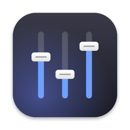

# MixBar



A macOS menu bar app that works like the Windows volume mixer:

- **Output switcher** – pick which connected output device (speakers, AirPods, HDMI, USB…) is the default, and set its master volume / mute.
- **Per-app volume** – every app that uses audio gets its own slider and mute button. Levels are shown for apps you have adjusted.
- **Media controls** – previous / play-pause / next buttons that drive whichever player is active, plus the current track from Spotify or Music when one is running.

Requires macOS 14.2 or newer (uses Core Audio process taps).

## Opening it

Click the three-sliders icon in the menu bar, or press **⌃⌥M** (Control + Option + M) from anywhere.
If the menu bar is full and the icon is hidden under the notch, the hotkey (or relaunching the app)
shows the mixer as a floating panel at the top-right of the screen instead.

Diagnostics are written to `~/Library/Logs/MixBar.log`.

## Build and run

```bash
./build.sh            # release build → build/MixBar.app
open "build/MixBar.app"
```

`./build.sh debug` builds a debug binary instead. The app is ad-hoc signed, so it runs locally without a developer account.

## Permissions

| Feature | Permission | When it is asked |
| --- | --- | --- |
| Per-app volume | System Audio Recording (Privacy & Security › Screen & System Audio Recording) | The first time you move an app slider away from 100% or mute an app |
| Media buttons | Accessibility | Click **Enable media keys** in the popover footer |
| Track name | Automation for Spotify / Music | The first time the popover opens while one of them is running |

## How per-app volume works

Core Audio does not expose a volume control per process, so the app uses a process tap
(`CATapDescription` with `mutedWhenTapped`). Tapping an app silences its direct output; the app's
audio is then replayed into the current output device through a private aggregate device with
the chosen gain applied. Apps left at 100% are not tapped at all, so they keep playing straight
to the device with no added latency. Volumes are remembered per bundle identifier.

## Icon

`App/Icon/make_icon.swift` draws the icon with AppKit; `iconutil` turns the iconset into `AppIcon.icns`:

```bash
cd App/Icon && swift make_icon.swift . && iconutil -c icns AppIcon.iconset -o AppIcon.icns
```

## Layout

```
Sources/MixBar/
  main.swift                 app entry
  App/AppDelegate.swift      status item + popover, MIXBAR_SNAPSHOT debug hook
  Audio/CoreAudioHelpers     typed wrappers for AudioObject properties and listeners
  Audio/OutputDeviceManager  output devices, default device, master volume/mute
  Audio/ProcessAudioManager  process objects → apps (groups helpers under their owning app)
  Audio/ProcessTap           tap + aggregate device + IO proc with gain
  Audio/MixerModel           per-app state, persistence, tap lifecycle
  Media/MediaKeys            play/pause/next/previous key events
  Media/NowPlaying           Spotify / Music track polling
  Views/MixerView            SwiftUI popover UI
```
